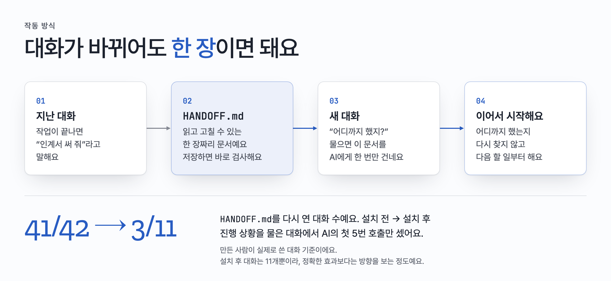

<p align="center">
  
</p>

<p align="center">
  <a href="https://sulabo.github.io/baton/ko/">홈페이지</a>
  ·
  <a href="docs/GUIDE.ko.md">가이드</a>
  ·
  <a href="README.md">English</a>
  ·
  <a href="CHANGELOG.md">변경 기록</a>
</p>

<p align="center">
  <a href="https://github.com/sulabo/baton/actions/workflows/ci.yml"></a>
  <a href="https://github.com/sulabo/baton/releases"></a>
  <a href="LICENSE"></a>
</p>

baton은 Claude Code와 Codex에서 쓰는 플러그인이에요. 새 대화에서 이어서 하자고 하면, AI에게 한 장짜리 인계서를 건네요. 그래서 AI가 프로젝트를 다시 읽는 일부터 시작하지 않아요.

저장소 안의 평범한 파일 두 개, `HANDOFF.md`와 `CONCEPTS.md`로 동작해요. 정해진 때에 도는 작은 스크립트(훅)를 써요.

> 버전 `1.0.0`이에요. 아래 숫자는 모두 만든 사람 한 명이 직접 써 보며 잰 거예요.

<p align="center">
  
</p>

## 왜 필요한가요

- **대화가 길어질수록 맥락이 커져요.** 맥락은 AI를 호출할 때마다 다시 보내는 대화 내용이에요. 만든 사람의 대화 60개(AI 호출 20번 이상, 메인 대화만, 2026-08-31–09-30)를 보면, 호출 한 번에 담기는 맥락의 중앙값이 첫 호출에서 약 **67K 토큰**이었어요. 50번째에는 **192K**, 100번째에는 **289K**가 됐어요. 늘어난 양의 절반쯤은 Bash 명령을 실행한 직후에 생겼어요(바로 앞 도구 호출의 몫으로 셌어요).
- **비용은 대부분 뒤쪽에서 나가요.** 같은 대화들에서 비용(API 가격 기준)의 <strong>85%</strong>가, 맥락이 첫 호출 크기의 2배를 넘은 뒤에 나갔어요.
- **입력이 길면 답이 나빠져요.** Chroma가 모델 18개로 시험했어요. 전체 기록(약 113K 토큰) 대신 관련 있는 부분만 추린 입력(약 300토큰)을 줬더니, 모든 모델이 훨씬 잘 답했어요. 원문은 "significantly higher performance on focused prompts compared to full prompts"예요([Context Rot, 2025](https://www.trychroma.com/research/context-rot)).
- **Anthropic 자료도 새로 시작하는 쪽을 가리켜요.** Claude Code 가이드는 관련 없는 작업 사이에 `/clear`를 쓰라고 권해요. 요청할 때마다 대화 전체를 보내기 때문이에요([Best practices](https://code.claude.com/docs/en/best-practices)). Anthropic이 Sonnet 4.5로 오래 걸리는 작업을 돌릴 때는, 맥락을 비우고 정리된 인계 문서를 넘겨받은 새 에이전트로 다시 시작했어요. 압축(compaction)으로는 "깨끗한 출발점이 생기지 않는다(doesn't give the agent a clean slate)"는 이유였어요. Opus 4.5부터는 이 리셋을 뺐어요([Harness design, 2026](https://www.anthropic.com/research/harness-design-long-running-apps)).

## baton을 쓰고 달라진 것

| 잰 것 | 결과 | 조건 |
|---|---|---|
| 진행 상황을 물은 뒤, AI가 첫 5번 호출 안에 `HANDOFF.md`를 다시 연 대화 | 설치 전 **42개 중 41개** → 설치 후 **11개 중 3개** | 실제로 쓴 대화예요. 설치 전은 2026-08-31–10-04, 설치 후는 10-19–11-20이에요. 일부만 읽은 경우도 셌어요(설치 전 41개 중 3개, 설치 후 3개 중 2개). 설치 후 대화가 11개뿐이라, 정확한 효과보다는 방향을 보는 정도예요 |
| 진행 상황을 물을 때 인계서를 넣은 경우 | 입력 토큰 **40–54% 감소**, 턴 수 중앙값 **5–6 → 3** | 실제 사용이 아닌 스냅숏 실험이에요. 저장소 3곳, 조건마다 3–5번, 저장소마다 같은 질문으로 했어요 |
| 인계서 없음, 요약 카드, 인계서 전체 비교 | `HANDOFF.md`를 다시 읽은 횟수: 인계서 없음과 카드(2.8–4.1KB)는 각각 **5번 중 5번**, 전체는 **5번 중 0번**이에요. 대화당 평균 비용(API 가격 환산): 인계서 없음 **$1.00**, 카드 **$0.88–1.05**, 전체 **$0.68** | 스냅숏 실험이에요. 저장소 1곳, 조건마다 5번, 2026년 9월, 최대 6턴이에요. 전체·카드 실험은 기준 실험과 번갈아 하지 않고 그 뒤에 했어요. 그래서 baton은 요약 대신 한 장 전체를 넣어요 |
| 작업이 끝난 시점에서 `/compact` vs 인계서 | baton 저장소만 셌어요(2026-11-25 정정). 정답: `/compact` **5번 중 5번**. 인계서는 1차 **5번 중 2번** → 인계서 쓰는 방식을 고친 뒤 2차 **5번 중 5번**이에요. 2차 비용: 인계서 쪽 비용이 `/compact`의 **1.7배**였어요(중앙값이고, 프롬프트 캐시가 살아 있다고 쳤을 때예요. 보고된 비용 그대로는 **1.2배**예요) | 미리 짠 긴 대화(약 24만 토큰), 저장소 1곳, 갈래마다 5번, 2026-11-24. 2차는 인계서 쪽만 다시 돌려 1차 `/compact` 결과와 비교했어요. 다른 저장소 하나는 뺐어요. 긴 대화를 만드는 동안 그 저장소에 `HANDOFF.md`가 생겨서, `/compact` 쪽에도 인계서가 들어갔기 때문이에요. 미리 정한 판정 규칙은 저장소 2곳이 있어야 해서, 규칙대로면 판정을 내릴 수 없어요(**결론 없음**). [자세히](docs/research/compact-vs-handoff.md#correction-2026-11-25) |
| 다음 날, 다른 작업에서 `/compact` vs 인계서 | 정답: `/compact` **6번 중 5번**, 인계서 **6번 중 4번**. 비용: 다음 날 아침에 압축하는 경우와 비교하면 **차이를 찾지 못했어요**(인계서 쪽 비용이 `/compact`의 **0.86배**, 중앙값. 미리 정한 규칙은 15% 차이가 있어야 해요). 전날 끝낼 때 압축해 두는 경우와 비교하면 `/compact`가 쌌어요(인계서 쪽이 **1.32배**) | 3차 실험, 2026-11-25. 같은 미리 짠 긴 대화(약 22만–24만 토큰), 저장소 2곳, 갈래마다 3번이에요. 인계서 비용은 작업이 끝난 시점에 프롬프트 캐시가 살아 있었다고 쳐서 셌고, 다음 날은 캐시가 사라진 채로 시작해요. 한 저장소에서는 인계서도 압축도 없이 시작한 대화까지 맞혀서(한 번은 그냥, 한 번은 옛 대화 기록 파일을 열어 규칙을 읽고), 그 저장소의 정답 수로는 둘을 가를 수 없어요. 인계서 쪽 오답 2번은 인계서에 규칙이 적혀 있었는데 프롬프트의 지시를 따른 경우예요. [자세히](docs/research/compact-vs-handoff-r3.md#results-2026-11-25) |
| 관련 없는 작업에 인계서를 넣은 경우 | 입력 토큰 약 **11% 증가** | 스냅숏 실험이에요. 저장소 1곳, 5번. 그래서 인계서는 물어볼 때만 넣어요 |
| 실제 사용에서의 토큰 | **아직 줄지 않았어요.** 첫 호출 맥락이 61–71K에서 77–87K로 늘었어요(주별 중앙값) | 같은 기간에 다른 플러그인이 처음부터 차지하는 맥락도 커졌어요. 사용 기록(2026-10-04–11-19)을 보면 같은 인계서가 여러 번 들어갔어요. 대화당 한 번만 넣도록 고친 효과는 아직 재지 못했어요 |

**아직 보여 주지 못한 것도 있어요.**

- **작성 시점 한 줄의 효과.** 작성일과 그 뒤 커밋 수를 알려 주는 한 줄이, AI가 낡은 인계서를 그대로 믿지 않게 해 주는지는 아직 몰라요. 한 시험 사례에서는 AI가 9번 모두 스스로 git을 확인했어요.
- **개념 지도의 값어치.** 개념 지도가 유지하는 비용만큼 값어치를 하는지도 아직 몰라요. 이득을 넉넉히 잡아도 4주 평균으로는 손해였고, 판단은 미뤄 뒀어요.
- **새로 시작할 때 아끼는 돈.** 새로 시작하는 게 실제로 돈을 아끼는지도 아직 재지 못했어요.

외부 연구 결과도 있어요. ETH 취리히 연구에서는 `AGENTS.md` 같은 저장소 설명 파일이 성공률을 대체로 올리지 못했고, 추론 비용은 평균 20% 넘게 늘렸어요([arXiv 2602.11988](https://arxiv.org/abs/2602.11988)). 인계서를 짧게 쓰고 물어볼 때만 넣는 이유가 하나 더 생긴 셈이에요.

숫자는 모두 만든 사람의 저장소에서 나왔어요. 출처와 명령은 [docs/research/LOOP_PLAN.md](docs/research/LOOP_PLAN.md), [docs/research/round2-E-ab.md](docs/research/round2-E-ab.md)에 있어요.

## 왜 baton인가요

- **작업이 끝나면 인계서를 써 둬요.** 한 대화에서 마지막 인계서 뒤로 파일을 3개 이상 고쳤으면, AI가 답을 마칠 때 baton이 `HANDOFF.md`를 갱신하라고 AI에게 말해요. AI는 갱신했다고 한 줄로 알려 줘요(Claude Code에서만, 대화마다 한 번). 언제든 "인계서 써 줘"라고 해도 돼요. 직접 읽고 고칠 수 있는 평범한 한 장짜리 파일이에요.
- **저장하면 바로 검사해요.** 길이, 꼭 있어야 하는 항목, 비밀값, 홈 폴더 경로, 직접 정해 둔 비공개 단어를 훅이 검사해요. 문제가 있으면 AI에게 돌려줘요(Claude Code 기준이에요. Codex에서는 스킬이 검사기를 직접 돌려요). 실패한 접근법이나 결정처럼, 마지막으로 커밋한 판에 있던 줄이 빠지면 그것도 알려 줘요.
- **대화당 한 번, 작성 시점과 함께 넣어요.** 다음 대화에서 "어디까지 했지?"라고 물으면 인계서가 한 번 들어가요. 파일이 바뀌었거나 대화가 압축됐으면 다시 들어가요. 언제 썼는지, 그 뒤 커밋이 몇 개인지 알려 주는 한 줄도 같이 들어가요. `(필독)`을 붙여 둔 항목은 최대 3개까지 그다음 한 줄에 따로 모아 넣어요.
- **맥락이 너무 커지기 전에 인계서를 남겨요.** 호출 한 번에 담기는 맥락이 25만 토큰을 넘을 때, 그리고 45만 토큰을 넘을 때(기본값) 그 턴에, 마지막 인계서 뒤에 한 일(파일 고침, 파일을 쓰는 명령, 맡긴 에이전트가 고친 것)이 있으면 AI가 인계서를 써 두고, 만든 사람의 기록으로 계산하면 이 크기부터는 새 대화로 넘어가는 쪽이 대개 더 싸다고 알려 줘요(Claude Code에서만 돼요). 문턱은 만든 사람의 대화 50개를 인계서 쓰는 비용까지 넣어 다시 계산해서 정했어요. 한 사람의 기록으로 낸 추정이에요. 그 대화들은 맥락 창이 100만 토큰이었어요. 창이 20만 토큰이면 25만에 닿기 전에 대화가 압축되어 이 규칙이 울리지 않아요. `BATON_SPLIT_TOKENS`를 낮출 수는 있지만, 그 크기에서 새로 시작하는 쪽이 더 싼지는 재지 않았어요(100만 토큰 창 기록에서는 15만이 대개 손해였어요).
- **바뀐 곳을 아는 개념 지도.** `CONCEPTS.md`는 개념마다 관련 결정, 코드, 문서를 묶어 둬요. `/drift`는 다시 볼 개념만 보여 줘요. 마지막 확인 뒤에 파일이 바뀌었거나, 확인한 기록이 없는 개념이에요.
- **내 컴퓨터에서 돌아요.** 훅은 내 컴퓨터에서 도는 Python·셸 스크립트예요. 스크립트를 검색해 보니 네트워크 호출은 없었어요(실행 중에 추적한 건 아니에요). `~/.cache/baton`에 작은 기록을 남기지만, 프롬프트 내용은 저장하지 않아요.

## 시작하기

Claude Code 안에서 설치해요(`git`과 `python3`가 필요해요).

```
/plugin marketplace add sulabo/baton
/plugin install baton@baton
```

그다음엔 이렇게 해요.

1. 새 대화에서 `/baton-doctor`를 실행해, 저장소가 준비됐는지 확인해요.
2. 작업을 마치면 "인계서 써 줘"라고 하고, `HANDOFF.md`를 커밋해요.
3. 다음 대화에서 "어디까지 했지?"라고 물어봐요.

메시지는 시스템 로캘(컴퓨터의 언어·지역 설정)이 한국어면 한국어로, 아니면 영어로 나와요. `BATON_LANG`을 `ko`나 `en`으로 정하면 직접 고를 수 있어요([언어](docs/GUIDE.ko.md#언어)).

<details>
<summary><strong>다른 방법:</strong> 설치한 뒤 이 프롬프트를 AI에게 붙여 넣어요</summary>

```md
이 저장소에 baton을 설치했어. driftmap 스킬로 이 저장소의 개념 지도(CONCEPTS.md)를 만들어 줘.
오늘 작업을 마치면, 다음 대화가 이어받을 수 있게 인계서(HANDOFF.md)를 써 줘.
```

</details>

<details>
<summary><strong>Codex</strong>(0.155 이상)</summary>

```bash
codex plugin marketplace add sulabo/baton
codex plugin add baton@baton
```

Codex에서는 플러그인 훅을 '신뢰함'으로 직접 표시해 줘야 훅이 돌아가요. 슬래시 명령이 없어서 스킬로 요청해야 해요(`/baton-doctor`는 쓸 수 없어요). 맥락이 커질 때의 알림, 인계서 자동 갱신과 제안, 저장할 때의 검사도 Codex에서는 돌지 않아요.

</details>

## 이럴 땐 맞지 않아요

- **긴 대화 하나를 계속 이어 간다면.** 그럴 땐 `/compact`와 `/resume`이 맞아요. baton은 새 대화를 시작할 때 쓰는 도구예요.
- **내가 아무것도 쓰지 않아도 AI가 기억해 주길 바란다면.** 대화를 자동으로 기록하는 [claude-mem](https://github.com/thedotmack/claude-mem)을 써 보세요.
- **커밋을 거의 하지 않는다면.** 인계서는 그대로 들어가지만, 작성 시점 한 줄과 `/drift`는 커밋된 기록만 기준으로 해요.

## 문서

인계서와 개념 지도가 어떻게 동작하는지, 모든 명령, 내 기록에 맞춰 설정하는 법, 다른 도구와의 비교, 개인정보, 한계, 자주 묻는 질문은 [docs/GUIDE.ko.md](docs/GUIDE.ko.md)에 있어요.

## 기여하기

버그 제보와 풀 리퀘스트를 환영해요. 큰 변경은 먼저 [이슈](https://github.com/sulabo/baton/issues)를 열어 주세요. 비밀값이나 보안 문제는 공개 이슈에 올리지 말아 주세요.

## 라이선스

[MIT](LICENSE)
