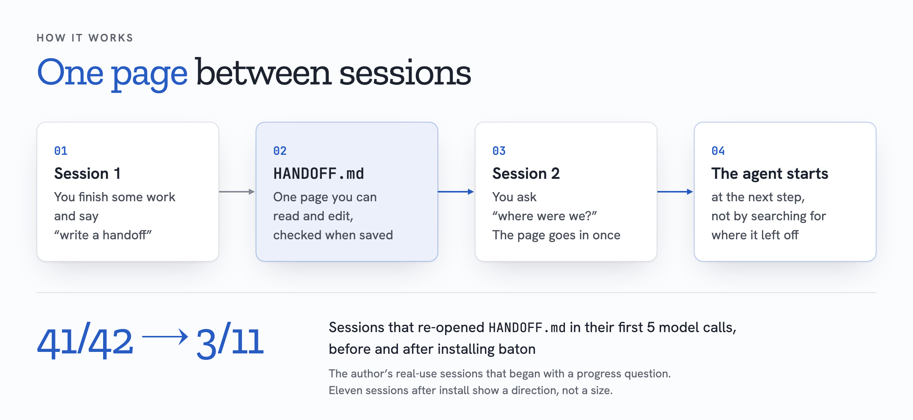

<p align="center">
  
</p>

<p align="center">
  <a href="https://sulabo.github.io/baton/">Homepage</a>
  ·
  <a href="docs/GUIDE.md">Guide</a>
  ·
  <a href="README.ko.md">한국어</a>
  ·
  <a href="CHANGELOG.md">Changelog</a>
</p>

<p align="center">
  <a href="https://github.com/sulabo/baton/actions/workflows/ci.yml"></a>
  <a href="https://github.com/sulabo/baton/releases"></a>
  <a href="LICENSE"></a>
</p>

baton is a plugin for Claude Code and Codex. When you ask a new session to pick up where you left off, it hands the agent a one-page handoff, so the agent doesn't start by re-reading your project.

It works on two plain files in your repo, `HANDOFF.md` and `CONCEPTS.md`, through local hooks (small scripts that run at set moments).

> Version `1.0.0`. Every number below comes from one person's use.

<p align="center">
  
</p>

## Why it matters

- **Context keeps growing inside a session.** In 60 of the author's sessions (20+ model calls, main thread only, 2026-08-31 to 09-30), the median context per model call went from about **67K tokens** at the 1st call to **192K** at the 50th and **289K** at the 100th. About half of that growth followed Bash commands (growth attributed to the tool call just before).
- **Most of the cost comes late.** In the same sessions, **85%** of the cost (weighted by API prices) came from calls made after the context had passed 2× its size at the first call.
- **Longer input, worse answers.** Chroma tested 18 models and saw "significantly higher performance on focused prompts compared to full prompts" across all of them: about 300 tokens of relevant history versus the full ~113K ([Context Rot, 2025](https://www.trychroma.com/research/context-rot)).
- **Anthropic's own guidance points to fresh starts.** Claude Code's guide suggests `/clear` between unrelated tasks, because every request sends the whole conversation ([Best practices](https://code.claude.com/docs/en/best-practices)). Anthropic's long-running harness for Sonnet 4.5 cleared the context and started a fresh agent with a structured handoff, since compaction "doesn't give the agent a clean slate". With Opus 4.5 it dropped those resets ([Harness design, 2026](https://www.anthropic.com/research/harness-design-long-running-apps)).

## What changed with baton

| What we measured | Result | Conditions |
|---|---|---|
| Agent re-reads `HANDOFF.md` in its first 5 model calls after a progress question | **41 of 42** sessions before install → **3 of 11** after | Real use, author's sessions, 2026-08-31 to 10-04 vs 10-19 to 11-20. Some read only part of it (3 of 41 before, 2 of 3 after). Eleven sessions show a direction, not a size |
| Progress question, handoff injected | **40–54% fewer** input tokens, median turns **5–6 → 3** | Snapshot runs, not real use: 3 repos, 3–5 runs per condition, same prompt within each repo |
| No handoff vs a summary card vs the whole handoff | Re-read `HANDOFF.md`: no handoff and the cards (2.8–4.1 KB) **5 of 5** runs each, whole page **0 of 5**. Average session cost (API-price equivalent): no handoff **$1.00**, cards **$0.88–1.05**, whole page **$0.68** | Snapshot runs, 1 repo, 5 runs per condition, September 2026, capped at 6 turns; the whole-page and card runs came after the baseline instead of alternating with it. This is why baton injects the whole page, not a summary |
| `/compact` vs a handoff at a task boundary | Baton repo only (corrected 2026-11-25). Correct: `/compact` **5 of 5**. Handoff **2 of 5** in round 1 → **5 of 5** in round 2, after the handoff fix. Cost in round 2: the handoff cost **1.7×** as much (median, with the prompt cache counted as warm; **1.2×** on the raw reported cost) | Scripted long session (about 240K tokens), 1 repo, 5 runs per arm, 2026-11-24. Round 2 reran only the handoff arm against round 1's `/compact` runs. A second repo was dropped: its build had written a `HANDOFF.md`, so its `/compact` runs also received the handoff. The pre-registered rule needs 2 repos, so it gives no verdict (**inconclusive**). [Details](docs/research/compact-vs-handoff.md#correction-2026-11-25) |
| Unrelated task, handoff loaded | about **11% more** input tokens | Snapshot runs, 1 repo, 5 runs. This is why the handoff goes in only when you ask |
| Tokens in real use | **not lower yet**. First-call context rose from 61–71K to 77–87K (weekly medians) | The fixed context of other plugins grew in the same period. The usage log (2026-10-04 to 11-19) showed the same handoff injected again and again; the once-per-session fix isn't measured yet |

**Not shown yet.** That the age line keeps an agent from trusting a stale handoff (in one test case, agents checked git on their own in 9 of 9 sessions). That the concept map pays for its upkeep (a deficit on a 4-week average even with an upper-bound estimate of the gain; verdict on hold). That starting fresh saves money in real use. And from outside: an ETH Zurich study found that repository context files such as `AGENTS.md` did not generally improve success rates while raising inference cost by over 20% on average ([arXiv 2602.11988](https://arxiv.org/abs/2602.11988)). That is one more reason to keep a handoff short and load it only when asked.

All our numbers come from the author's own repositories. Sources and commands: [docs/research/LOOP_PLAN.md](docs/research/LOOP_PLAN.md) and [docs/research/round2-E-ab.md](docs/research/round2-E-ab.md).

## Why baton?

- **A one-page handoff, written when a piece of work ends.** Once 3 or more files were edited in a session since the last handoff, baton asks the agent at the end of its turn to update `HANDOFF.md` and to tell you in one line (Claude Code, once per session). You can still say "write a handoff" at any time. It is a plain file you can read and edit.
- **Checked when saved.** A hook checks length, required sections, secrets, home-folder paths, and the private words you pick, and hands any problem back to the agent (Claude Code; on Codex the skill runs the checker). It also warns when lines from the last committed version are gone, such as a failed approach or a decision.
- **Loaded once, with its age.** Ask "where were we?" in the next session. The handoff goes in once per session (again if the file changed or the conversation was compacted), with a line saying how old it is and how many commits came after it. Up to 3 entries you marked "(must read)" come next, in one line of their own.
- **A handoff before the context balloons.** When the context passes 2× and 3× its size at the first call (defaults), the agent saves a handoff and tells you that you can pick up in a new conversation (Claude Code only).
- **A concept map that knows what changed.** `CONCEPTS.md` ties each concept to its decision, code, and docs. `/drift` shows which concepts need a re-check: files changed since the last check, or no check recorded.
- **Local.** The hooks are Python and shell scripts on your machine. A search of the scripts found no network calls (not a runtime trace). They keep a small log under `~/.cache/baton` that never stores prompt text.

## Get started

Inside Claude Code (you need `git` and `python3`):

```
/plugin marketplace add sulabo/baton
/plugin install baton@baton
```

Then:

1. Run `/baton-doctor` in a new session to check that the repo is ready.
2. Finish some work and say "write a handoff". Commit `HANDOFF.md`.
3. In the next session, ask "where were we?".

Messages are in Korean when your system locale is Korean, and in English otherwise. Set `BATON_LANG` to `en` or `ko` to choose ([Language](docs/GUIDE.md#language)).

<details>
<summary><strong>Alternative:</strong> paste this prompt to your agent after installing</summary>

```md
baton is installed in this repo. Build a concept map for this repo with the driftmap skill (CONCEPTS.md).
When we finish today's work, write a handoff (HANDOFF.md) so the next session can pick up from it.
```

</details>

<details>
<summary><strong>Codex</strong> (0.155+)</summary>

```bash
codex plugin marketplace add sulabo/baton
codex plugin add baton@baton
```

Codex runs plugin hooks only after you mark them as trusted. It has no slash commands, so ask for the skills instead (`/baton-doctor` isn't available there). The context-growth notice, the handoff auto-write and nudge, and the save-time check don't run on Codex.

</details>

## When not to use it

- **You keep one long conversation going.** `/compact` and `/resume` are built for that; baton is for starting a new session.
- **You want recall without writing anything.** Try [claude-mem](https://github.com/thedotmack/claude-mem), which records sessions automatically.
- **You rarely commit.** The handoff still loads, but its age line and `/drift` count committed history only.

## Documentation

How the handoff and the concept map work, every command, tuning to your own history, a comparison with other tools, privacy, limitations, and the FAQ: [docs/GUIDE.md](docs/GUIDE.md).

## Contributing

Bug reports and pull requests are welcome. Open an [issue](https://github.com/sulabo/baton/issues) first for anything large, and please don't post secrets or security problems in a public issue.

## License

[MIT](LICENSE)
